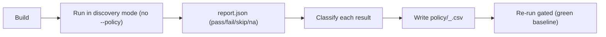

# Bringing up a new platform

Use this when you run the suite on hardware it has never seen (e.g. MI450) and
there is no `policy/<gpu>_<nic>.csv` for the platform. The rule is simple:

> **No config = run everything.** The suite does not need a platform config to
> start. It runs every test as `MUST_PASS`, and you turn that first run into a
> policy — so there is no "wrong config" to pick.

This avoids the mismatch of grabbing an unrelated config (e.g. ionic) on new
hardware: you never adopt another platform's classifications, you derive your own.

**Reuse first — don't multiply configs.** If your platform is already shipped
(`mi350_ionic` / `mi350_thor`), its policy is auto-selected and there is nothing
to author. Auto-selection prefers `policy/<gpu>_<nic>.csv` and falls back to a
bare `policy/<nic>.csv` if one exists; otherwise it runs in discovery mode (no
`--policy`). Writing a new `policy/<gpu>_<nic>.csv` is a deliberate, one-time step
reserved for genuinely new hardware — not something to do on every run.

## Flow



## 1. Build and run in discovery mode

Do not pass `--policy` or `--vendor`. The NIC vendor is auto-detected; if no
matching policy file exists, the suite prints a `WARN` and runs everything as
`MUST_PASS` with the gate active (`mode=discovery` in the report).

```bash
cmake -S . -B build -DCMAKE_BUILD_TYPE=Release \
      -DACCEPT_WITH_HIP=ON -DACCEPT_WITH_IBVERBS=ON -DCMAKE_PREFIX_PATH=/opt/rocm
cmake --build build -j

# HIP (single node)
./build/hva --filter-category 'hip/*' --kind func --report hip_discovery.json
# Verbs (two ranks on one host, or add -hosts h1,h2 for two nodes)
./build/hva -n 2 --filter-category 'verbs/*' \
      --kind func --report verbs_discovery.json
```

Discovery mode treats everything as `MUST_PASS`, so genuine failures/skips will
show as gate failures — that is expected and is exactly the signal you want. Add
`--kind perf` if you also want baseline metrics captured in the same run.

## 2. Classify each result

Go through the report and decide the intended class for every non-passing test:

| Observed | Likely class | Why |
|---|---|---|
| pass | `MUST_PASS` | works on this platform; keep it required |
| skip (missing symbol / old ROCm) | `SKIP` + `when` | software-gated, not a defect |
| fail because feature absent by design | `NA` | permanently not applicable on this HW |
| fail = real, tracked bug | `KNOWN_FAILURE` + ticket | keeps fix pressure, gate stays red |
| fail = genuine regression | `MUST_PASS` (leave failing) | must be fixed before this platform ships |

```bash
python3 -c 'import json;d=json.load(open("hip_discovery.json"));
[print(t["status"].ljust(6), t["id"], "|", t.get("reason") or "") for t in d["tests"]]'
```

## 3. Write the policy

Create `policy/<gpu>_<nic>.csv` (e.g. `mi450_thor.csv`): `<gpu>` from the
gfx->marketing map (gfx950->mi350, gfx942->mi300, ...), `<nic>` the NIC name the
suite auto-detected, shown in the `WARN` line and in the report
`environment.vendor`. One row per test:

```csv
# policy/<gpu>_<nic>.csv  — columns: test,class,when,expected,ticket,reason
Memcpy_Size_Sweep,MUST_PASS,,,,
StreamGetId_Stable,SKIP,rocm>=7.1,,,requires hipStreamGetId (ROCm >= 7.1)
Texture_Object_Lifecycle,NA,,,,no image hw on CDNA3+
Vmm_Map_NoDeadlock_KernelInFlight,KNOWN_FAILURE,,fail,ROCM-25387,hipMemMap deadlock behind in-flight kernel
```

Format details and `when`-expressions: [POLICY_REFERENCE.md](POLICY_REFERENCE.md).
Copying an existing file (e.g. `policy/mi350_ionic.csv`) as a starting point is fine —
just re-classify every row against *this* platform's discovery results rather than
trusting the source platform's classes.

## 4. Re-run gated

```bash
./build/hva --vendor <gpu>_<nic> --policy policy/<gpu>_<nic>.csv \
      --filter-category 'hip/*' --kind func --report hip.json
```

A correct policy yields `ACCEPTANCE: PASS` (exit 0) when only expected skips/NAs
remain, or a red gate that points precisely at the real regressions and tracked
bugs. Commit `policy/<gpu>_<nic>.csv` as the platform's baseline.

> Tip: the `acceptance-summarize` skill gives a per-category breakdown of a
> discovery run and lists each failure with its reason, which helps you classify
> each row. See [../.cursor/skills/](../.cursor/skills/).
